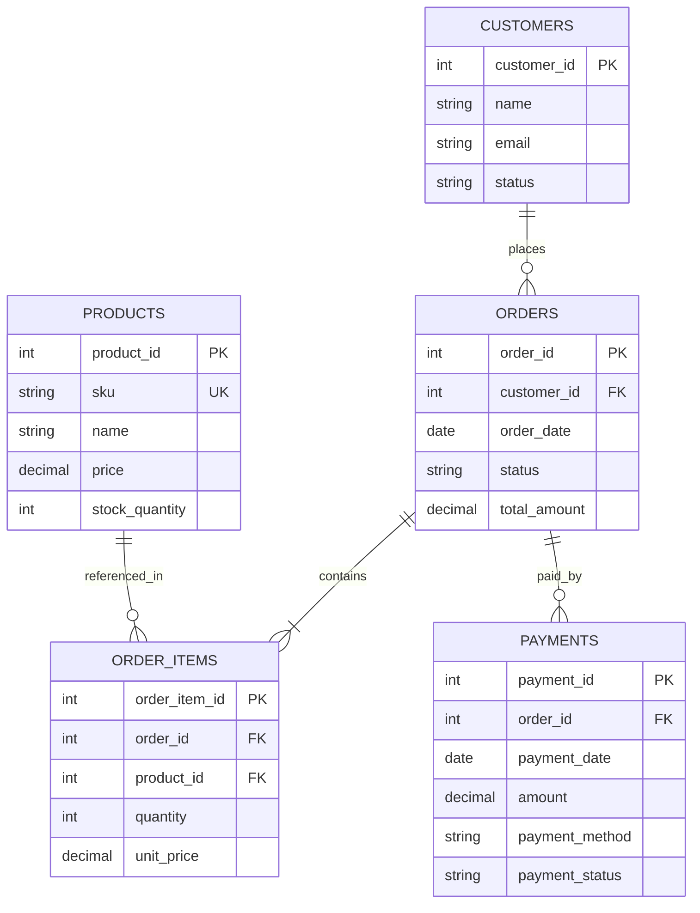

# E-Commerce Order & Inventory Support Simulation (Pure SQL)

A simple, lightweight SQL project resolving **10 production support tickets** on an e-commerce database.

---

## 📁 Project Structure

```
e-commerce_support_simulation/
├── schema.sql                     # 5 normalized tables with PKs, FKs, & constraints
├── seed_data.sql                  # ~550 rows of realistic messy data
├── support_tickets_resolution.sql # Pure SQL resolving 10 support tickets
├── run_simulation.py              # Simple 1-click test runner (built-in sqlite3)
└── README.md                      # Documentation & resume guide
```

---

## 🗄️ Relational Schema

Five normalized tables connected by foreign keys and business constraints:



---

## 🎫 10 Support Tickets Resolved

1. **Deduplicate Customers**: Merges orders from duplicate accounts to primary accounts and deletes duplicates in a transaction.
2. **Reconcile Stuck Orders**: Advances paid orders from `'PENDING'` to `'PROCESSING'`.
3. **Daily Health Reports**: Aggregates daily payment failure rates and low-stock products.
4. **Slow Query Tuning**: Adds composite index on `(customer_id, order_date DESC)` and verifies plan improvement via `EXPLAIN`.
5. **Clean Orphan Records**: Deletes orders, order items, and payments referencing non-existent parent records.
6. **Order Total Discrepancy**: Re-syncs header `total_amount` with line item sums (`quantity * unit_price`).
7. **Oversold Stock Tracking**: Detects orders placed for products with `stock_quantity = 0`.
8. **Refund Double Charges**: Detects multiple `'PAID'` entries for the same order and marks duplicate charges as `'REFUNDED'`.
9. **Cancel Stale Orders**: Cancels abandoned orders in `'PENDING'` status that have no payment.
10. **Customer Lifetime Tiers**: Creates view `vw_customer_tiers` classifying customers into `VIP` and `STANDARD` tiers.

---

## 🚀 How to Run

```powershell
python run_simulation.py
```

Output:
```text
1. Running schema.sql...
2. Running seed_data.sql...
3. Running support_tickets_resolution.sql...

--- RESULTS VERIFICATION ---
Ticket 1  (Deduplicate Customers):       0 duplicates remaining [PASS]
Ticket 2  (Reconcile Stuck Orders):      0 stuck orders remaining [PASS]
Ticket 3  (Alert Reports):               24 failure dates reported [PASS]
Ticket 4  (Index Optimization):          SEARCH orders USING INDEX idx_orders_customer [PASS]
Ticket 5  (Clean Orphan Records):        0 unlinked orders remaining [PASS]
Ticket 6  (Fix Order Discrepancies):     0 discrepant orders remaining [PASS]
Ticket 7  (Oversold Stock Tracking):     3 out-of-stock items tracked [PASS]
Ticket 8  (Refund Double Charges):       0 duplicate charges remaining [PASS]
Ticket 9  (Cancel Stale Orders):         0 stale orders remaining [PASS]
Ticket 10 (Customer Lifetime Tiers):     12 VIP customers identified [PASS]

All 10 production tickets executed and verified successfully.
```

---

## 💼 How to Write It on Your Resume

```markdown
**Retail Order & Inventory Database Support Simulation** | *PostgreSQL, SQL, Relational Modeling*
- Designed a normalized 5-table relational schema enforcing referential integrity and constraints (PK, FK, CHECK, NOT NULL) to prevent invalid order states.
- Wrote transactional SQL cleanup scripts (BEGIN / COMMIT / ROLLBACK) to resolve simulated L2 production support tickets, including duplicate customer accounts, stuck payment states, and orphan records.
- Reduced query execution time on order-lookup reports by creating targeted composite indexes verified via EXPLAIN query execution plans.
```
