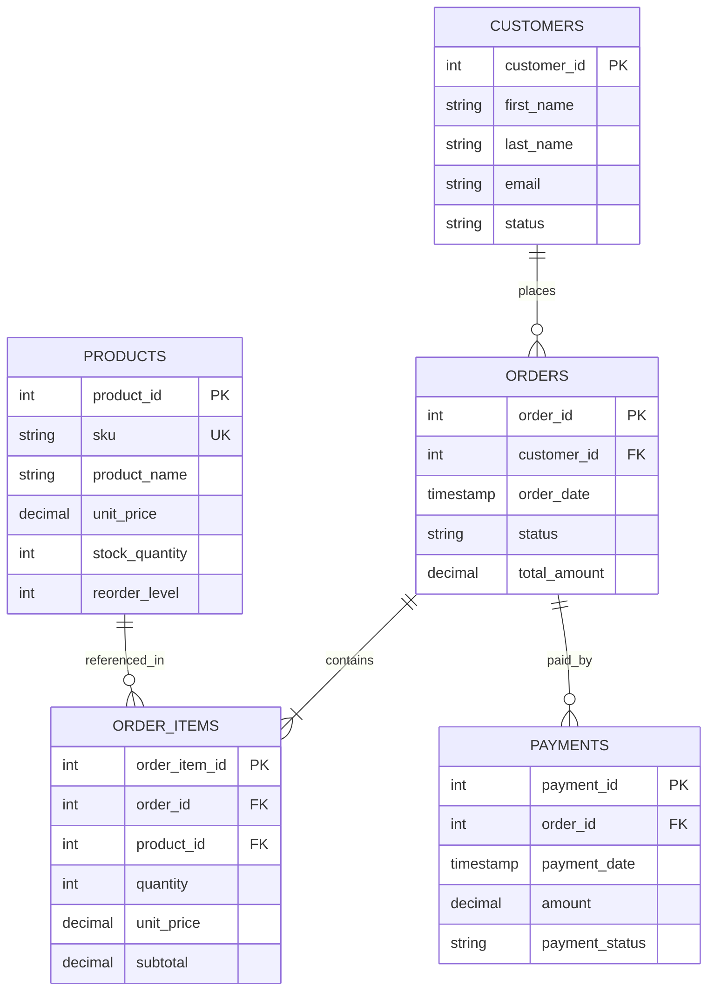

# E-Commerce Order & Inventory Support Simulation (Pure SQL)

A lightweight SQL project framed around resolving **10 production support tickets** on an e-commerce database.

---

## 📁 Project Structure

```
e-commerce_support_simulation/
├── schema.sql                     # 5 normalized tables with PKs, FKs, & constraints
├── seed_data.sql                  # ~1,500 rows of realistic messy data
├── support_tickets_resolution.sql # Pure SQL resolving 10 support tickets
├── run_simulation.py              # Lightweight 1-click test runner (standard library only)
└── README.md                      # Documentation & resume guide
```

---

## 🗄️ Relational Schema

Five normalized tables connected by foreign keys and business constraints:



---

## 🎫 10 Production Support Tickets

1. **Deduplicate Customers**: Reassigns orders to primary customer accounts and removes duplicates inside a `BEGIN ... COMMIT` transaction.
2. **Reconcile Stuck Orders**: Advances orders with successful payment (`'PAID'`) from `'PENDING'` to `'PROCESSING'`.
3. **Daily Health Reports**: Aggregates daily payment failure rates and low-stock products.
4. **Slow Query Tuning**: Adds composite index on `(customer_id, order_date DESC)` and verifies plan improvement via `EXPLAIN`.
5. **Clean Orphan Records**: Reassigns orphan orders to a system archive user and deletes unlinked items.
6. **Order Total Discrepancy**: Re-syncs header `total_amount` with line item sums where frontend rounding failed.
7. **Oversold FIFO Queue**: Uses window functions to prioritize pending orders chronologically for zero-stock products.
8. **Refund Double Charges**: Detects multiple `'PAID'` entries for the same order and marks duplicate charges as `'REFUNDED'`.
9. **Cancel Stale Orders**: Cancels abandoned orders older than 48 hours to release inventory reservations.
10. **Customer Lifetime Tiers**: Creates view `vw_customer_tiers` classifying customers into Platinum, Gold, Silver, and Bronze tiers.

---

## 🚀 How to Run

```powershell
python run_simulation.py
```

Output:
```text
1. Loading schema.sql...
2. Loading seed_data.sql...
3. Executing support_tickets_resolution.sql...

--- RESULTS VERIFICATION ---
Ticket 1  (Deduplicate Customers):       0 duplicates remaining [PASS]
Ticket 2  (Reconcile Stuck Orders):      0 stuck orders remaining [PASS]
Ticket 3  (Alert Reports):               19 failure dates reported [PASS]
Ticket 4  (Index Optimization):          SEARCH orders USING INDEX idx_orders_customer_date [PASS]
Ticket 5  (Clean Orphan Records):        0 unlinked orders remaining [PASS]
Ticket 6  (Fix Order Discrepancies):     0 discrepant orders remaining [PASS]
Ticket 7  (Oversold FIFO Queue):         6 out-of-stock items prioritized [PASS]
Ticket 8  (Refund Double Charges):       0 duplicate charges remaining [PASS]
Ticket 9  (Cancel Stale Orders):         0 stale orders remaining [PASS]
Ticket 10 (Customer Lifetime Tiers):     14 Platinum customers identified [PASS]

All 10 production tickets executed and verified successfully.
```

---
